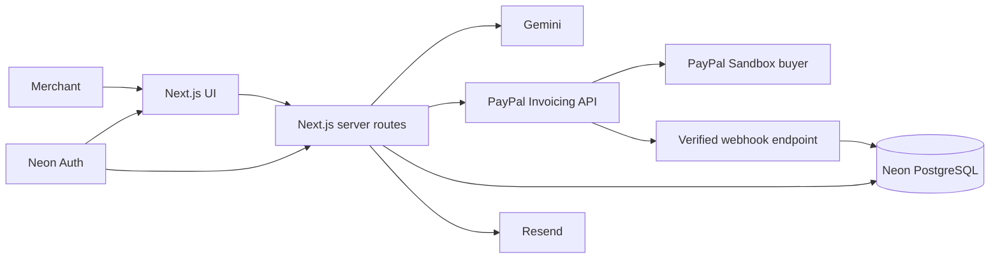

# ClearSettle

**An AI revenue copilot that turns completed work into a reviewed PayPal invoice, tracks payment status, and helps merchants follow up without losing control.**

- Hosted app: [clearsettle.vercel.app](https://clearsettle.vercel.app/)
- Devpost submission copy: [docs/DEVPOST_SUBMISSION.md](docs/DEVPOST_SUBMISSION.md)
- License: [MIT](LICENSE)

## The problem

Independent merchants often finish the work but still have to translate an informal agreement into a correct invoice, understand what PayPal did with it, and write awkward payment reminders. The process becomes harder across currencies, countries, and multiple line items.

ClearSettle reduces that administrative gap while keeping the merchant in charge. AI prepares drafts and explanations; the merchant reviews every financial or communication action before it reaches PayPal or a customer.

## What ClearSettle does

1. The merchant describes completed work in plain language.
2. Gemini converts the description into a structured, editable invoice with customer, due date, currency, and multiple line items.
3. The merchant reviews and edits every field before confirming.
4. ClearSettle creates and sends the invoice through PayPal Invoicing API v2.
5. Verified PayPal webhooks update the stored invoice status, including payment.
6. For an unpaid invoice, AI drafts a contextual reminder for merchant approval.
7. The merchant can send PayPal's standard reminder or approved personalized copy through Resend.

ClearSettle never creates, sends, or follows up on an invoice solely because the model suggested it.

## Working features

- Gemini Structured Outputs for natural-language invoice extraction.
- Editable multi-item invoices with quantity, unit price, and exact total previews.
- Deterministic, visibly labeled demo extraction when no Gemini key is configured.
- PayPal Sandbox invoice creation, sending, and buyer checkout.
- Live invoice status from verified PayPal webhook events.
- AI-generated collection reminders with editable tone and content.
- Personalized reminder delivery through Resend and PayPal-native reminders.
- Neon PostgreSQL ledgers for invoice idempotency, webhook events, and reminder history.
- Neon Auth email/password sessions with a server-enforced merchant email allowlist.
- Replay-resistant webhooks, duplicate suppression, and integer-based money calculations.

## Why the AI integration is meaningful

AI is used for work that depends on language and context rather than for payment authorization:

- It extracts invoice fields and multiple line items from an unstructured description.
- It identifies missing or ambiguous information before the PayPal request is created.
- It drafts a reminder using the customer, invoice amount, due date, lateness, and prior context.
- Its output is schema-constrained, validated again on the server, displayed for editing, and never auto-sent.

## Why the PayPal integration is meaningful

PayPal is the transaction system rather than a decorative checkout link:

- ClearSettle creates invoices through PayPal Invoicing API v2.
- The merchant separately approves sending the draft.
- The buyer completes payment in PayPal Sandbox.
- Signed PayPal webhook events drive the stored invoice status.
- PayPal's reminder endpoint provides a native follow-up option.
- PayPal invoice IDs connect creation requests, webhook events, and reminder history.

## Architecture



## Technology

| Layer | Technology | Purpose |
| --- | --- | --- |
| Application | Next.js 16, React, TypeScript | Responsive UI and server routes |
| AI | Google Gemini, Zod | Structured invoice extraction and reminder drafting |
| Payments | PayPal Invoicing API v2, PayPal webhooks | Invoice creation, sending, payment, status, reminders |
| Data | Neon PostgreSQL, Drizzle ORM | Durable invoice, webhook, and reminder records |
| Authentication | Neon Auth | Sessions and server-side workspace access control |
| Email | Resend | Approved personalized reminders |
| Hosting | Vercel | Public HTTPS deployment and server functions |
| Quality | Vitest, ESLint, TypeScript | Tests, linting, and static verification |

## Run locally

Requirements: Node.js 22+, npm, a Neon database, and Neon Auth.

```powershell
git clone https://github.com/yking-ly/ClearSettle.git
Set-Location ClearSettle
Copy-Item .env.example .env.local
npm install
npm run db:migrate
npm run dev
```

Open [http://localhost:3000](http://localhost:3000). Create a Neon Auth account using an email included in `AUTH_ALLOWED_EMAILS`.

The AI and payment portions can run in visibly labeled demo mode, but authentication fails closed until its three variables are configured.

## Configuration

Never commit `.env.local` or copy secrets into an issue, screenshot, or submission form.

| Variable | Required | Source and purpose |
| --- | --- | --- |
| `DEMO_MODE` | No | Set `true` for deterministic invoice creation without external AI or PayPal calls |
| `NEON_AUTH_BASE_URL` | Yes | Branch Auth URL from Neon; injected automatically by the Neon–Vercel integration when Auth is enabled |
| `NEON_AUTH_COOKIE_SECRET` | Yes | App-owned random secret of at least 32 characters for signed session cookies |
| `AUTH_ALLOWED_EMAILS` | Yes | Comma-separated emails permitted to use the merchant workspace |
| `GEMINI_API_KEY` | No | Google AI Studio key for AI extraction and reminders |
| `GEMINI_MODEL` | No | Gemini model name; defaults to the value in `.env.example` |
| `PAYPAL_ENV` | For PayPal | Use `sandbox` for the hackathon build |
| `PAYPAL_CLIENT_ID` | For PayPal | PayPal Sandbox REST application credential |
| `PAYPAL_CLIENT_SECRET` | For PayPal | Server-only PayPal Sandbox REST application secret |
| `PAYPAL_WEBHOOK_ID` | For webhooks | ID of the webhook registered on the same PayPal application |
| `DATABASE_URL` | For PayPal writes | Neon pooled PostgreSQL connection string |
| `RESEND_API_KEY` | For personalized email | Server-only Resend API key |
| `REMINDER_FROM_EMAIL` | For personalized email | Sender on a Resend-verified domain |
| `REMINDER_TEST_RECIPIENT` | No | Routes non-deliverable Sandbox buyer addresses to a real test inbox |

Generate the cookie secret on any machine with Node.js:

```powershell
node -e "console.log(require('crypto').randomBytes(32).toString('base64'))"
```

### PayPal Sandbox setup

1. In the PayPal Developer Dashboard, create or select a Sandbox REST application attached to the Sandbox Business merchant.
2. Add its client ID and secret to the server environment.
3. Create a Neon database and run `npm run db:migrate` before making real PayPal writes.
4. Register `https://your-domain.example/api/paypal/webhooks` on the same PayPal application.
5. Subscribe to the invoicing events used by the demo, including created, sent, updated, paid, refunded, scheduled, and cancelled events.
6. Store the resulting webhook ID as `PAYPAL_WEBHOOK_ID`.
7. Use a Sandbox Personal account as the invoice buyer.

The PayPal Webhooks Simulator does not support the postback verification used here. Test the full flow with a real Sandbox invoice event.

### Neon Auth setup

1. Enable Auth for the Neon production branch.
2. Use the generated branch Auth URL as `NEON_AUTH_BASE_URL`.
3. Generate `NEON_AUTH_COOKIE_SECRET` locally.
4. Put the merchant's sign-in email in `AUTH_ALLOWED_EMAILS`.
5. Add the same values to Vercel Production and Preview before deploying the auth-enabled commit.

### Personalized reminder setup

Verify a sending domain in Resend, then configure `RESEND_API_KEY` and `REMINDER_FROM_EMAIL`. Because PayPal Sandbox uses non-deliverable `example.com` buyer addresses, use `REMINDER_TEST_RECIPIENT` to send the test message to a real inbox. The override is ignored in live PayPal mode.

PayPal-native reminders use PayPal's system-defined email content. ClearSettle does not claim that custom AI copy is delivered through that endpoint; personalized AI copy is sent only through the explicit Resend option.

## Security and financial safety

- PayPal, Gemini, Resend, database, and cookie secrets remain server-side.
- Every merchant-facing API checks the Neon Auth session and email allowlist.
- The PayPal webhook is session-free because PayPal calls it; it instead requires PayPal signature headers, a fresh transmission timestamp, and successful PayPal postback verification.
- Invoice creation and reminder delivery use idempotency keys and durable database claims.
- Duplicate PayPal event IDs are stored once.
- Invoice totals use integer minor units rather than floating-point arithmetic.
- AI output crosses a Zod validation boundary and remains editable.
- Financial and communication actions always require merchant confirmation.

## Verification

```powershell
npm run typecheck
npm run lint
npm test
npm run test:integration
npm run build
```

The integration test requires a configured test database. Unit tests, lint, type checking, and the production build do not require live PayPal transactions.

## Current limitations

- The hackathon build uses PayPal Sandbox and does not move real money.
- Allowlisted users share one merchant workspace; data is not yet tenant-isolated per user.
- Reminders require merchant action and are not scheduled automatically.
- Webhooks are handled synchronously instead of through a background job queue.
- ClearSettle tracks PayPal invoice state but does not yet reconcile deposits against bank settlements.
- Currency conversion and PayPal fees are not estimated before PayPal reports the actual transaction.

## Submission access

The hosted build must remain usable by judges. Before submitting, either provide a dedicated Sandbox demo login through Devpost's permitted access instructions or ensure the repository setup above can be completed without private assistance. Never publish PayPal, Neon, Gemini, or Resend secrets.

## License

ClearSettle is open source under the [MIT License](LICENSE).
